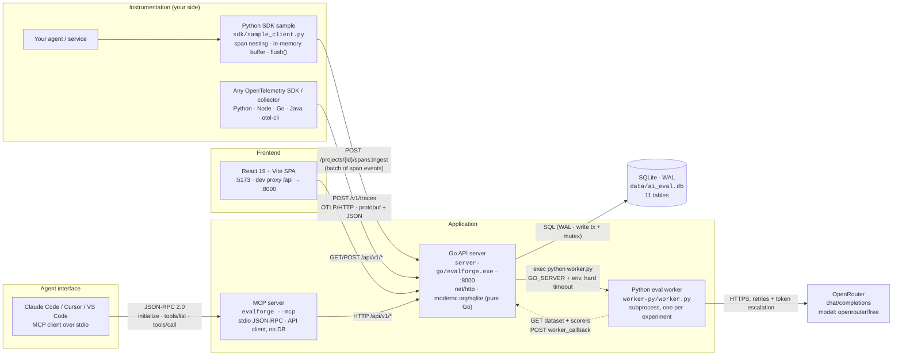
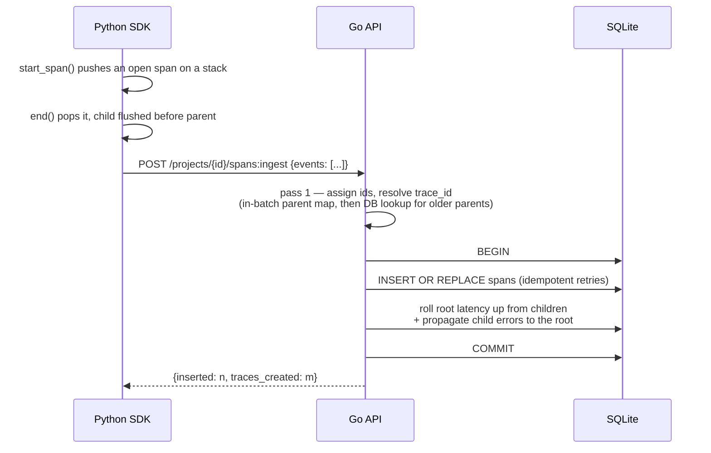
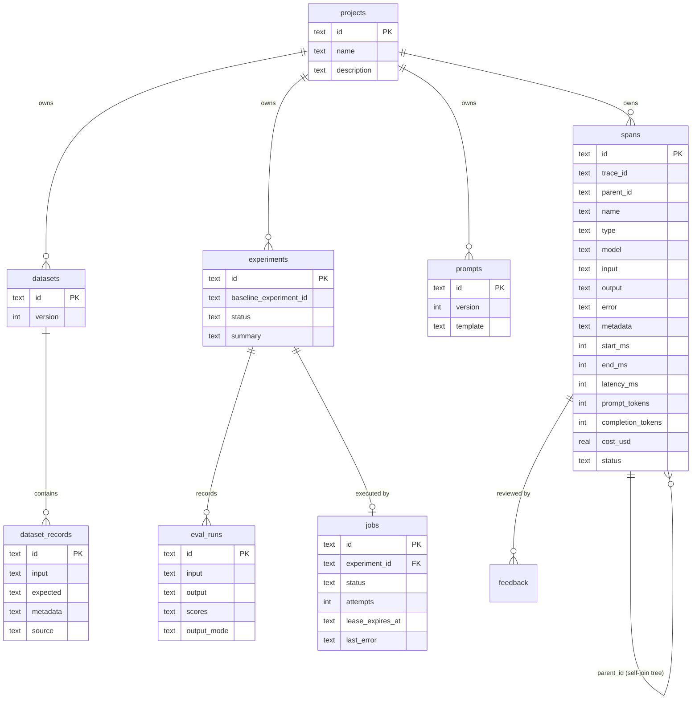

# Architecture — EvalForge

High-level system design as **actually implemented** (not as intended). Every component below exists in
this repo; the "gaps" section is explicit about what does *not* exist yet.

---

## 1. System context



**Runtime topology:** two processes plus a file. The Go server is the only thing that touches the
database; the worker talks back over the same public HTTP API a third-party client would use, which
keeps the worker replaceable.

| Process | Tech | Port / artifact | Why this choice |
|---|---|---|---|
| API server | Go 1.x, stdlib `net/http`, `modernc.org/sqlite` (pure Go, no cgo) | `:8000` (`ADDR`), `server-go/evalforge.exe` | One static binary, no runtime deps, no cgo toolchain on Windows |
| Eval worker | Python 3.12, stdlib only (`urllib`, `json`, `concurrent.futures`) | spawned by the server, `worker-py/worker.py` | Scorer/judge code stays in Python without giving the API server an event loop |
| Frontend | React 19 + Vite, `react-router-dom`, hand-written CSS | `:5173`, proxies `/api` → `:8000` | Fast iteration, tiny bundle, no UI framework |
| Storage | SQLite in WAL mode, JSON columns for payloads | `data/ai_eval.db` | MVP scale; WAL lets readers run during a write, and the schema maps 1:1 to Postgres |
| Provider | OpenRouter OpenAI-compatible API | `https://openrouter.ai/api/v1` | One key, many models; offline fallback if unset |

---

## 2. Request flow — trace ingest



Key behaviours:

- **Ids** are `<unix-nanos>-<sequence>`; the sequence suffix exists because Windows clocks have ~15 ms
  granularity and two spans used to collide on the primary key.
- **Children may arrive before their parent** (the SDK flushes on span end), so trace-id resolution is a
  second pass, not a single parent lookup.
- **Cost** is computed at ingest from the in-memory price table (`gpt-4o`, `gpt-4o-mini`, `gpt-4.1`,
  `claude-sonnet-4`, `llama-3.1-8b`, `*default*`) over estimated tokens (`len(json)/4`) unless the client
  sends real `prompt_tokens` / `completion_tokens`.
- The whole batch runs in **one transaction**; any query started inside it must go through the
  transaction (a pooled query inside a write transaction was the original deadlock). Writes are
  serialised by `dbMu`; reads run concurrently under WAL.

### OTLP path

`POST /v1/traces` accepts `application/x-protobuf` (what every OTel SDK sends by default) and
`application/json`, decodes into `ExportTraceServiceRequest`, and maps each span onto the same rows.
Two details that are easy to get wrong:

- **OTLP/JSON uses hex ids while protojson expects base64.** Feeding hex straight to protojson parses
  without error but stores a different trace id, so a batch of hex ids is normalised before decoding.
  The regression test asserts the stored id equals the exporter's hex id.
- **Idempotency comes from the wire id**: the OTLP `span_id` becomes our primary key, so a retried
  batch cannot duplicate spans, and no separate dedupe table is needed.

An empty export is valid OTLP: it returns `200` and creates no project.

---

## 3. Request flow — evaluation

```mermaid
sequenceDiagram
  participant UI as Browser
  participant API as Go API
  participant DB as jobs table
  participant W as Python worker
  participant LLM as OpenRouter

  UI->>API: POST /projects/{id}/evaluations<br/>{dataset_id, scorer_names, baseline_experiment_id}
  API->>DB: BEGIN; INSERT experiment(running); INSERT job(queued); COMMIT
  API-->>UI: {experiment_id}   (returns immediately)
  loop dispatcher tick (500 ms)
    API->>DB: claim oldest claimable job<br/>(UPDATE … SET status=running, lease=now+45s)
    API->>W: exec python worker.py --experiment-id …<br/>(heartbeat renews the lease every 15 s)
    W->>API: GET /datasets/{id} → records · GET /scorers → registry
    loop records, 4 in parallel
      W->>LLM: generate task output (retry + token escalation)
      W->>W: deterministic scorers (local)
      W->>LLM: LLM judges → {score, rationale}
    end
    W->>API: POST /worker_callback/{exp_id} {runs, summary, status}
    API->>API: DELETE old runs, INSERT new, status = completed (idempotent)
    API->>DB: job done
  end
  note over API,DB: crash → boot requeues running jobs · dead worker → lease expires → reaper requeues<br/>abnormal exit → retry (max 2) · timeout → failed with a reason
  UI->>API: GET /experiments/{id} (polls every 3 s while running)
```

Every score carries provenance: `judge_mode ∈ {deterministic, llm, heuristic_fallback, provider_error,
unparseable}` and every run carries `output_mode ∈ {llm, simulated_fallback}`. A judge that fails to
answer is recorded as **no score**, never as `0.0` — a silent zero would drag the mean down and look
like a real regression.

---

## 4. Data model



A **trace is not its own table**: the root span (`parent_id IS NULL`) *is* the trace row, and
trace-level model/cost are aggregated from child spans at query time. This is what makes
production→eval promotion cheap, and it is also the main thing that would need denormalising at scale.

Live row counts in the demo database: 119 spans (36 traces), 9 dataset records, 25 eval runs,
4 experiments, 2 prompts, 1 job. The `scorers` table exists but is **empty and unused** — the registry
is a Go literal (`builtinScorers`).

`jobs` is the only table that is *mutable control state*: it is claimed with a single conditional
`UPDATE`, leased with a heartbeat, and repaired by a reaper. Everything else is append-mostly.

---

## 5. API surface

| Area | Endpoints | Notes |
|---|---|---|
| Projects | `GET/POST /projects`, `GET /projects/{id}` | filtered to the credential's project scope |
| Ingest | `POST /projects/{id}/spans:ingest` | our batch format, idempotent by span id (`INSERT OR REPLACE`) |
| Ingest (OTLP) | `POST /v1/traces` (also `/api/v1/projects/{id}/otel/v1/traces`) | OTLP/HTTP, **protobuf and JSON**; project from the `project-name` header (auto-created); empty export = `200` no-op; maps `gen_ai.*`, `llm.*`, OpenInference attributes |
| Observe | `GET /projects/{id}/traces` (+ filters: status, model, search, min_latency, min_cost, has_feedback, sort), `GET /projects/{id}/traces/{tid}`, `POST …/feedback` | trace list aggregates model + cost across the trace |
| Dashboard | `GET /projects/{id}/dashboard?hours=` | count, error rate, p50/p95/p99, tokens, cost, model split, bucketed series |
| Datasets | `GET/POST /projects/{id}/datasets`, `GET /datasets/{id}`, `POST /datasets/{id}/records` (object **or** array), `POST /datasets/{id}/records:from_trace` | promotion copies root input + your corrected `expected` + `metadata.origin_trace_id` |
| Evaluate | `GET /scorers`, `POST /projects/{id}/evaluations`, `GET /projects/{id}/experiments`, `GET /experiments/{id}`, `GET /experiments/{id}/compare?baseline_id=` | comparison aligns cases by `input` |
| Prompts | `GET/POST /projects/{id}/prompts` | versioned, **not yet used by evals** |
| Internal | `POST /worker_callback/{experiment_id}` | only the worker calls this |

---

---

## 5b. Agent interface (MCP)

Opik ships `opik-mcp` so Claude Code, Cursor and VS Code can drive the platform, and a full OAuth 2.1
authorization server (`/oauth/authorize`, `/oauth/token`, `/oauth/register`, PKCE S256) so remote MCP
clients can authenticate. MCP is not an ingestion protocol — it is the *interface AI agents use to
operate the product*.

We implement the same idea, including the authorization server, because remote MCP clients need it:

```bash
MCP_API_BASE=http://localhost:8000 MCP_API_KEY=efk_... ./server-go/evalforge.exe --mcp   # local
curl -X POST https://eval.example.com/mcp -H "Authorization: Bearer efa_..." ...          # remote
```

- **Transports:** stdio (newline-delimited JSON-RPC 2.0, what a host spawns) and Streamable HTTP
  (`POST /mcp`, stateless — no session ids, so any instance behind a load balancer can serve a request).
  Logs go to stderr; stdout carries protocol messages only.
- **Protocol:** `initialize` negotiates `2025-06-18` (also accepts `2025-03-26`, `2024-11-05`),
  `tools/list`, `tools/call`, `ping`; unknown tools are protocol errors (`-32602`), tool failures are
  `result.isError = true`, notifications get `202`.
- **Architecture:** the MCP layer is a *client of the public HTTP API*, not a second writer. It opens
  no database, so it can run on a laptop against a remote server without changing any semantics — and
  every tool call forwards the caller's own credential, so the agent can never exceed it.
- **Authorization (RFC 9728 + RFC 8414):** an unauthenticated request gets `401` with
  `WWW-Authenticate: Bearer resource_metadata="…/.well-known/oauth-protected-resource"`. A compliant
  client then discovers the authorization server, registers dynamically (RFC 7591), runs
  authorization-code + PKCE S256, and presents the short-lived bearer token. `Origin` is validated so a
  browser page cannot drive a local server (DNS-rebinding defence).

| Tool | What an agent can do with it |
|---|---|
| `list_projects` | discover what exists |
| `search_traces` | filter by status/model/text/feedback, sort by latency or cost |
| `get_trace` | read the nested span tree, tokens, cost, feedback |
| `get_dashboard` | error rate, p50/p95/p99, cost, model split |
| `list_datasets` / `get_dataset` | inspect evaluation inputs and expected outputs |
| `list_experiments` / `get_experiment` | check status, scores, per-case results |
| `compare_experiments` | "did this change help?" — deltas, improvements, regressions |
| `add_feedback` | record a human review |
| `run_evaluation` | launch an experiment and poll it |

That makes the whole loop reachable from an editor: *"compare the last two experiments and tell me which
cases regressed"* is one tool call plus reasoning, not a browser session.

**Security note:** with `AUTH_MODE=required` the MCP endpoint requires a credential and enforces
per-tool scopes (`read` for the read tools, `write` for `add_feedback` / `run_evaluation`), and a
project-scoped key stays project-scoped inside the agent. With `AUTH_MODE=off` the endpoint is open by
design, so keep that deployment on loopback.

---

## 6. Is this Braintrust?

**No.** This is an original implementation of the same *product loop*, written from a research doc
([REVERSE_ENGINEERING.md](REVERSE_ENGINEERING.md)) that records observed facts about Braintrust plus our
own inferences. No Braintrust code, UI or assets are used. What it shares is the architecture of the
problem, which is the point of the exercise.

How faithful is it, honestly:

| Capability | Braintrust (observed) | Ours | Verdict |
|---|---|---|---|
| Product loop (trace → review → dataset → experiment → compare) | core feature | implemented end to end | **faithful** |
| Span tree | `span_id` / `root_span_id` / `span_parents` (DAG-capable) | `trace_id` + single `parent_id` (tree only) | simplified — no DAG |
| Immutable experiments | yes | yes (`experiments` + `eval_runs` never mutated except callback replace) | **faithful** |
| Scorers | deterministic code + LLM judges + autoevals + classifiers | 6 deterministic + 2 LLM judges, provenance-tagged | partial — no custom code scorers, no classifiers |
| Dataset versioning | versioned, rows may reference a trace | integer `version`, promotion references origin trace | partial — version is a counter, not a snapshot |
| Ingest protocol | REST insert + OTLP | REST batch + **OTLP/HTTP** (protobuf + JSON) | **faithful** — verified with the real Python OTel SDK |
| Storage | analytical/columnar + object storage | one SQLite file | far simpler; fine for MVP |
| Scale model | queue + worker fleet | durable `jobs` table + one dispatcher, one worker subprocess per eval | partial — survives crashes, not horizontally scalable |
| Auth / RBAC / multi-tenancy | orgs, roles, service tokens | none (single tenant, localhost) | **major gap** |
| Metering (bytes + scores) | the billing model | not implemented | gap (commercial, not functional) |
| Prompts at runtime | fetch by slug, used by evals | stored + versioned, unused | **gap** |
| Agent interface | `opik-mcp` + OAuth for MCP clients | `evalforge --mcp` (stdio) + `POST /mcp` (Streamable HTTP), 11 tools, OAuth 2.1 AS | partial — no `resources`/`prompts` primitives, no server→client progress stream |
| OTel / tracing ecosystem | OTLP, SDKs in several languages | OTLP/HTTP ingest (protobuf + JSON) verified with the real Python SDK; no first-party SDK yet | partial |

So: **valid as a working system**, faithful on the loop, the data semantics and the ingest protocol,
deliberately simple on storage and enterprise concerns.

---

## 7. What's missing (prioritised)

### P0 — the things that make it real
1. **OTLP ingest** (`POST /v1/traces`) — **done**. Protobuf + JSON, `project-name` routing, idempotent by
   span id; verified end-to-end with the Python OTel SDK. Any exporter can now send traces without our SDK.
2. **Durable job execution** — **done**. A `jobs` row owns each evaluation: claim/lease with heartbeat,
   boot requeue, reaper for expired leases, one retry on abnormal exit. Proven by hard-killing the server
   mid-eval and restarting (see §9).
3. **Prompts actually used in evaluation.** `POST /evaluations` takes no `prompt_id`, so the Prompts
   page is decorative. Wire `prompt_id` → worker renders the template → that is what an A/B eval means.
4. **Auth + projects scoped to a user/org.** — **done**: API keys with `read`/`write`/`admin` scopes,
   optional project scoping, and an OAuth 2.1 authorization server (PKCE S256, dynamic registration,
   refresh rotation with reuse detection, revocation, hourly token scrub). `AUTH_MODE=required` turns
   enforcement on. Still missing: orgs/teams as first-class objects and per-project ACLs beyond one
   scope per credential.

### P1 — the things that make it useful
5. **Dataset snapshots.** `version` is a counter; two experiments can silently compare different data.
   Store an immutable snapshot per experiment run.
6. **Custom scorers.** Drop the empty `scorers` table or populate it; allow a config-driven scorer
   (regex/JSON-path/threshold) without editing Go.
7. **Token/cost from the provider's `usage`.** We estimate `len/4`; OpenRouter returns real usage and
   `cost`, which would make the dashboard honest.
8. **Sampling + retention.** Trace tables grow forever; add per-project retention and head sampling.
9. **Frontend e2e tests.** The UI is verified by hand; a Playwright flow over the 5-step loop would
   protect it.

### P2 — the things that make it sellable
10. **Postgres/ClickHouse target** behind the same SQL shape; SQLite is a demo constraint.
11. **Metering** (ingested span bytes, recorded scores) — the pricing model the market already validates.
12. **Alerts/monitors** on error rate, p95, and score regressions in production.
13. **Full OpenTelemetry semantic conventions** — `gen_ai.*`, `llm.*` and OpenInference keys are mapped;
    tool/message attributes and events are not.
14. **Multi-instance safety** — the job queue is safe against crashes but assumes one writer process;
    a second instance would need the reaper interval tuned and a shared lease clock.

---

## 8. Where to look in the code

| Concern | File |
|---|---|
| Routing, handlers, schema, worker dispatch | [server-go/main.go](../server-go/main.go) |
| Durable job queue (claim/lease/reaper) | [server-go/jobs.go](../server-go/jobs.go) |
| OTLP/HTTP ingest + attribute mapping | [server-go/otlp.go](../server-go/otlp.go) |
| Request id, access log, panic recovery, CORS | [server-go/middleware.go](../server-go/middleware.go) |
| MCP server (stdio + Streamable HTTP, 11 tools) | [server-go/mcp.go](../server-go/mcp.go), [server-go/mcp_http.go](../server-go/mcp_http.go) |
| API keys + OAuth 2.1 authorization server | [server-go/auth.go](../server-go/auth.go) |
| Scorers, judges, prompt rendering, job loop | [worker-py/worker.py](../worker-py/worker.py) |
| Demo data (talks only to the HTTP API) | [worker-py/seed.py](../worker-py/seed.py) |
| Batching + nesting reference client | [sdk/sample_client.py](../sdk/sample_client.py) |
| Isolated 31-check end-to-end test | [scripts/smoke_api.py](../scripts/smoke_api.py) |
| Fault injection (crash/timeout/retry) | [scripts/fault_test.py](../scripts/fault_test.py) |
| MCP protocol test (stdio client) | [scripts/mcp_test.py](../scripts/mcp_test.py) |
| Auth end-to-end test (keys, PKCE, scopes) | [scripts/auth_test.py](../scripts/auth_test.py) |
| Concurrent ingest + query benchmark | [scripts/load_test.py](../scripts/load_test.py) |
| Design research (observed vs inferred) | [REVERSE_ENGINEERING.md](REVERSE_ENGINEERING.md) |

---

## 9. Verification and measurements

Everything below was executed against the code in this repository, not inferred. Commands are the ones
you can re-run; numbers are from one machine (Windows 11, Go 1.27, local SSD, single process) and are
indicative, not a benchmark claim.

### 9.1 Handler tests — the wire contract

```bash
cd server-go && go test ./... -count=1
```

| Test | Proves |
|---|---|
| `TestOTLPProtobufIngest` | protobuf export → 2 spans, hex trace id preserved, model/tokens/cost mapped, root tree addressable, **retry does not duplicate** |
| `TestOTLPJSONIngestAndEmptyBatch` | JSON export works, and the hex→base64 conversion keeps the exporter's trace id; empty batch returns 200 and creates no project |
| `TestOTLPRejectsGarbage` | malformed protobuf/JSON → `400`, not a panic or a 500 |

Result: `ok evalforge` (11 tests: 3 OTLP, 8 auth).

### 9.2 Contract smoke — the whole API on a private server

```bash
python scripts/smoke_api.py
```

Spawns its own server on a free port with a throw-away `DATA_DIR` and no provider key, then drives
ingest → traces → feedback → dashboard → datasets → prompts → evaluation → compare.

Result: **31/31 checks**, demo database untouched.

### 9.3 Fault injection — does it survive failure?

```bash
python scripts/fault_test.py
```

| Scenario | What was done | Observed |
|---|---|---|
| Crash mid-eval | Start eval, wait for `jobs.running = 1`, `taskkill /T /F` the server (kills worker too) | Experiment + job both left `running` — i.e. genuinely stranded. After restart: log line `requeued orphaned jobs count=1`, experiment reaches `completed`, **3 runs, 3 distinct records, 3 scored**, job `done` |
| Hung worker | `WORKER_TIMEOUT_SECONDS=2` with a worker that sleeps 120 s | Experiment `failed` in ~2 s with `{"error":"worker timed out after 2s"}`; job `failed` |
| Worker crashes once | Fixture exits `3` on its first attempt | Job retried (`attempts=2`), experiment `completed`, **3 runs — no duplicates** |

Result: **16/16 checks**. Note the queue is at-least-once: `attempts` can exceed the number of real
failures when a lease expires, which is why the callback replaces runs instead of appending.

### 9.4 Load — concurrent ingest and reads

```bash
python scripts/load_test.py            # 360 traces, 6 threads
```

| Measurement | Run A | Run B |
|---|---|---|
| Native ingest (360 requests / 1,080 spans) | **1.40 s → ~769 spans/s** | 2.76 s → ~392 spans/s |
| Per-request ingest latency | p50 21.7 ms · p95 39.3 ms | p50 45.1 ms · p95 78.6 ms |
| OTLP/HTTP JSON (60 batches, 4 threads) | p95 82.0 ms · 0 errors | p95 46.6 ms · 0 errors |
| `GET /traces?limit=50` | p50 18.0 ms · p95 32.9 ms | p50 11.0 ms · p95 33.6 ms |
| `GET /dashboard` | p50 9.9 ms · p95 31.0 ms | p50 7.9 ms · p95 27.5 ms |
| Integrity | 360/360 traces, 0 errors, 0 duplicates | same |

Two runs are shown because the write path is sensitive to machine load (the second run overlapped other
work). The **read** path is stable at ~33 ms p95; ingest is the noisy one. What is not noisy is
correctness: both runs stored exactly 360 traces with zero HTTP errors from 6 concurrent writers.

This is what WAL bought: before, every read waited behind the single write connection.

### 9.5 UI end-to-end — the loop a user actually performs

Driven in a real browser against the running dev server (screenshots in `screenshots/`):

1. Opened trace `1792481033309372800-117` ("401 on every call").
2. Left a thumbs-up with a comment → feedback row created (`kind=thumbs, value=up`).
3. Corrected the expected answer and clicked **+ Add to dataset** → dataset `Support regression cases`
   went **v3 → v4**, 6 → 7 records, `metadata.origin_trace_id` = the trace.
4. Selected that dataset, picked a baseline, clicked **▶ Run evaluation** → navigated to the new
   experiment, which moved `running → completed` **without a manual reload**.
5. Result page shows per-scorer means, per-case deltas vs baseline, and per-score provenance
   (`deterministic` / `llm` / `no-score`).

Backend check for that run: experiment `completed`, **7 runs**, job `done` with `attempts=1`.

### 9.6 Real OTel SDK (already in the repo history)

A Python `opentelemetry-sdk` exporter pointed at `POST /v1/traces` with `project-name` produced a
2-span trace, `model=gpt-4o-mini`, `50/20` tokens, `cost=1.95e-05` — matching the price table. This is
what caught the OTLP/JSON hex-id corruption.

### 9.7 MCP — protocol compatibility, not just a handshake

```bash
python scripts/mcp_test.py     # 23 checks: handshake, 11 tools, reads, writes, eval, errors
```

The test spawns the API on a temp database, then talks to `evalforge --mcp` over stdio: initialize →
`tools/list` → `tools/call`. It asserts that reads match the API, that `add_feedback` writes land, that
`run_evaluation` started over MCP completes and `compare_experiments` aligns against the baseline, and
that bad input is rejected without killing the process. Result: **23/23**.

Independently, the **official `mcp` Python SDK** connected as a real client:

```
protocol: 2025-06-18
server: ai-eval-platform 1.0.0
tools: 11 ['add_feedback', 'compare_experiments', 'get_dashboard', 'get_dataset'] ...
projects via MCP: ['Demo Support Agent']
traces: 36 first: support_agent gpt-4o-mini
dashboard requests: 36 p95: 3515 isError: False
```
(The SDK run predates the rename; the server now reports `evalforge 1.1.0`.)

### 9.8 Auth — keys, OAuth 2.1 and what an attacker cannot do

```bash
python scripts/auth_test.py    # 44 checks on a private server, AUTH_MODE=required
(cd server-go && go test ./...)   # 11 Go tests, including 8 auth ones
```

The script boots a second private server with `AUTH_MODE=required` and drives the flow a remote MCP
client performs: discovery → dynamic registration → authorize (consent form, PKCE S256) → code exchange
→ `POST /mcp` with the bearer token → refresh → revocation. Result: **44/44**. It asserts the failures
that matter, not just the happy path:

| Claim | How it is checked |
|---|---|
| Open deployments still bootstrap safely | first `POST /keys` on an empty database is allowed once and forced to `admin`; afterwards it is `401` |
| Keys are not recoverable from a leak | listing never contains the plaintext; only the SHA-256 hex is stored |
| Scopes are enforced server-side | read key: `GET` 200, `POST /projects` 403, `GET /keys` 403 |
| A project-scoped credential cannot cross projects | other project → `404` (not `403`, so existence is not confirmed), and `GET /projects` returns a filtered array |
| PKCE is mandatory and real | missing challenge, `plain` method, wrong verifier and unregistered redirect all rejected without a redirect |
| Codes are single-use | exchange once → 200; replay → `invalid_grant`, family revoked |
| Refresh tokens rotate | old token refused, reuse revokes the family (the rotated access token then 401s) |
| Revocation cascades | revoking a key kills every token derived from it |
| The MCP channel cannot be driven cross-site | foreign `Origin` → 403, loopback origin → 200, no token → 401 with `resource_metadata` |
| Per-tool scopes | read-only token: `list_datasets` 200, `add_feedback` → `isError` "insufficient scope" |

Two implementation notes worth keeping:

- **PKCE verification was wrong at first** and the test caught it: the verifier was hashed with the
  token hash function (hex SHA-256) and compared to a base64url challenge — always false. The fix is a
  dedicated `pkceMatches` helper; the failing assertion was not weakened.
- **Rejected requests drain their body** before answering. On Windows, leaving unread bytes in the
  socket makes the server close with RST and some clients report a connection reset instead of the 401
  that was written. The test client also retries only idempotent requests (GETs and pre-auth rejects);
  mutating calls are never retried, because a retried tool call could apply twice.

### 9.8 What these numbers do **not** prove

- They are single-node SQLite numbers. They say nothing about a multi-tenant deployment, and the queue
  assumes one writer process.
- The provider is a free router: LLM-judge scores vary between runs by design (that is why `judge_mode`
  and `no-score` are surfaced instead of coerced to `0.0`).
- UI verification is scripted in the browser, not a CI Playwright suite; it is evidence, not a
  regression gate.
